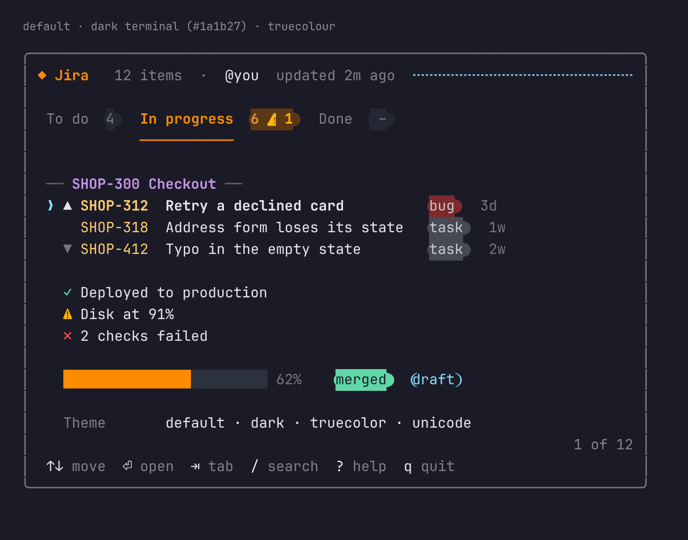
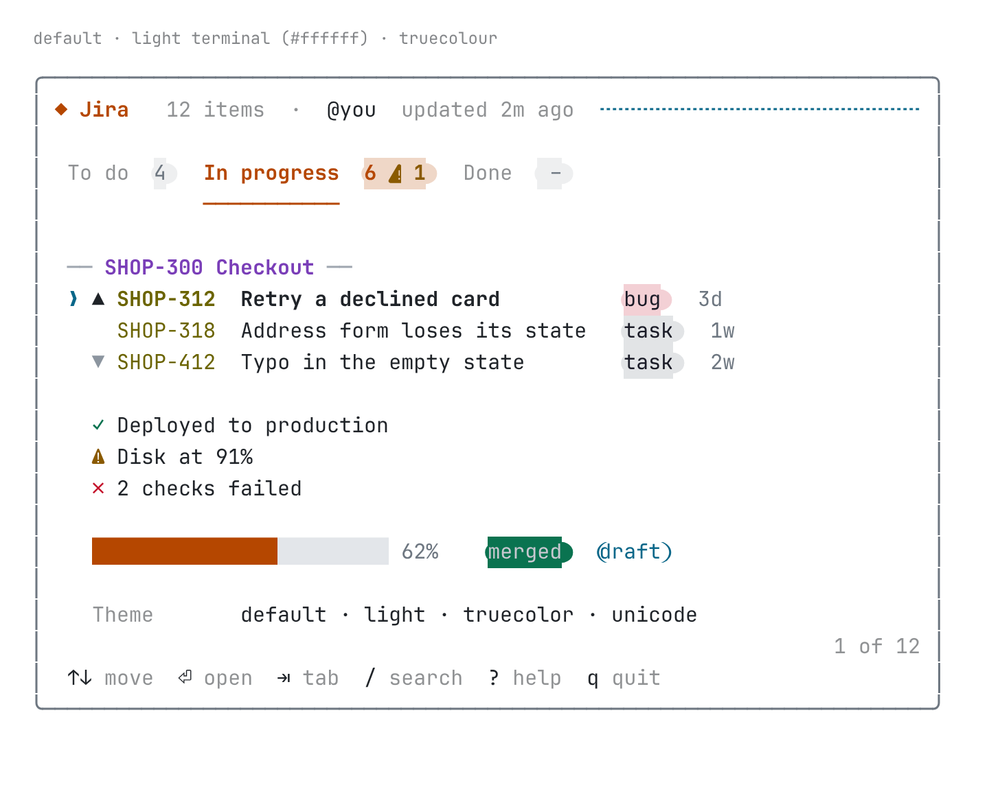
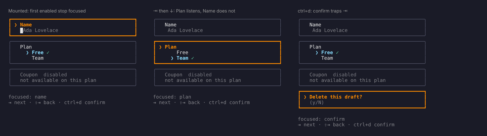
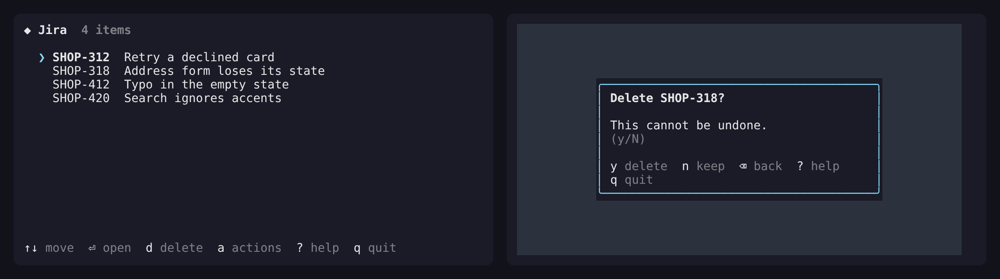

<div align="center">


**React component library for Ink CLIs**

<a href="https://kud.io/projects/ink-ui">Website</a> · <a href="https://kud.io/projects/ink-ui/docs">Documentation</a>

</div>

## Features

- **27 ready-made components**, pre-styled and ready to drop in:
  - **Inputs** — `TextInput`, `EmailInput` (domain completion), `PasswordInput` (masked), `ConfirmInput`
  - **Lists** — `UnorderedList`, `OrderedList` (both nestable), `Table` (sortable, selectable, virtualised to ten thousand rows with `useTable`, plus a `statusColumn` helper)
  - **Selection & navigation** — `Select`, `MultiSelect`, `Tabs`, `Switch`, `Toggle`, `SelectableRow`
  - **Status & feedback** — `Spinner`, `ProgressBar`, `SkeletonBar`, `SkeletonRows`, `StatusMessage`, `Alert`, `Badge`, `Toast`
  - **Layout & chrome** — `Banner`, `Header`, `Panel` (bordered pane, optional focus state), `Card` (six-line status card), `Columns`, `FooterHints`, `KeyValue`, `LoadingScreen`, `ScrollView`
- **Behaviour hooks** — `useTabs`, `useListCursor` and `useTable` own the keyboard state that every consumer used to hand-roll, so Tab/Shift+Tab and arrow/vim navigation behave the same everywhere
- **Full [@inkjs/ui](https://github.com/vadimdemedes/ink-ui) parity** — every upstream component has an equivalent, plus a dozen more the design system adds on top
- **Colourblind-safe by design** — state is signalled by shape, case, and glyph, never colour alone
- **Design tokens included** — a shared colour palette (`colors`) and spacing scale (`spacing`) to keep every screen consistent
- **Full TypeScript support** — ships compiled output with `.d.ts` declarations for every component and token type
- **ESM only, zero config** — no runtime bundling step; just import and render
- **Peer-dependency light** — only requires `ink ≥ 7` and `react ≥ 19`

## Install

```sh
npm install @kud/ink-ui
```

`ink` and `react` are peer dependencies and must be installed separately:

```sh
npm install ink react
```

### Building with an AI agent

The package ships `AGENTS.md`, a short brief covering the composition rules and house conventions that the type definitions cannot express — which components own the keyboard, what to compose for a given screen, and the traps. Point your agent at it:

```
node_modules/@kud/ink-ui/AGENTS.md
```

## Usage

```tsx
import React from "react"
import { render } from "ink"
import { Banner, Header, Badge, Spinner, colors } from "@kud/ink-ui"

const App = () => (
  <>
    <Banner title="my-tool" subtitle="v1.0.0" />
    <Header subtitle="Synchronising files…">Status</Header>
    <Badge variant="success">done</Badge>
    <Spinner label="Loading…" />
  </>
)

render(<App />)
```

Inputs report their value through `onChange`/`onSubmit`, and lists nest with a shape-distinct marker per level:

```tsx
import { Text } from "ink"
import { EmailInput, PasswordInput, UnorderedList } from "@kud/ink-ui"

const SignUp = () => (
  <>
    <EmailInput placeholder="you@example.com" onSubmit={setEmail} />
    <PasswordInput placeholder="Password" onSubmit={setPassword} />
    <UnorderedList>
      <UnorderedList.Item>
        <Text>Choose a plan</Text>
        <UnorderedList>
          <UnorderedList.Item>
            <Text>Free</Text>
          </UnorderedList.Item>
          <UnorderedList.Item>
            <Text>Pro</Text>
          </UnorderedList.Item>
        </UnorderedList>
      </UnorderedList.Item>
    </UnorderedList>
  </>
)
```

Components stay presentational and controlled — they take `active`/`value` and render. The behaviour hooks supply the keyboard state to drive them, so the two compose without either forcing the other:

```tsx
import { Tabs, useTabs, useListCursor } from "@kud/ink-ui"

const items = [
  { value: "open", label: "Open", count: 3 },
  { value: "done", label: "Done" },
]

const Inbox = ({ rows }) => {
  const { active } = useTabs(items) // Tab or → forward, Shift+Tab or ← back, wraps
  const { cursor } = useListCursor(rows.length) // ↑/↓ and k/j, clamps at the ends
  return <Tabs active={active} items={items} />
}
```

Both take `{ isActive }` so a screen with several focus regions can gate them, and `useListCursor` takes `{ wrap }` for genuinely circular lists. `useTabs` wraps by default because a tab bar is a ring; `useListCursor` clamps because a list has ends.

### Theme and terminal capabilities

One answer for what the terminal can display, read by every component. Probe the terminal **before** Ink's `render()` — Ink takes stdin over as it mounts — then wrap the app in one `ThemeProvider`:

```tsx
import React from "react"
import { render } from "ink"
import { ThemeProvider, probeTerminal } from "@kud/ink-ui"

const capabilities = await probeTerminal() // ~200 ms at most, never throws

render(
  <ThemeProvider capabilities={capabilities}>
    <App />
  </ThemeProvider>,
)
```

`probeTerminal()` reads the environment first (TTY, `CI`, `NO_COLOR`, `FORCE_COLOR`, `COLORTERM`, `TERM_PROGRAM`/`_VERSION`, `TERM`, the locale), then — on an interactive terminal outside tmux and CI — sends one batch of queries ending with DA1 (XTVERSION, DECRQM 2026, OSC 11). It returns the colour level, a light or dark background, synchronized output, kitty graphics and hyperlink support. No answer means unsupported.

The provider picks the theme: `default` at the terminal's depth (truecolour, 256 or 16 colours), light or dark from the reported background; `plain` whenever there is no colour. Pass `name="minimal"` for the 16 ANSI colours only, or `background="light"` to override. Every colour derives from `@kud/glyphs`' `colors.json`. Components read the same policy — colour, motion, static output, screen reader, and an `ascii` glyph set on a locale that is not UTF-8 — through `useTheme()`:

```tsx
const theme = useTheme()
theme.colors.accent // "#FF8C00", "ansi256(208)", "yellow" or undefined
theme.glyphs.success // "✓", or "+" in ASCII
theme.policy.motion // false for NO_MOTION, a pipe, a screen reader
```

Without a provider, components draw exactly as before and still honour `NO_COLOR`, `NO_MOTION` / `REDUCE_MOTION`, piped output and `INK_SCREEN_READER`.

| Dark terminal | Light terminal |
| --- | --- |
|  |  |

`minimal`, `plain` and the `ascii` glyphs: [assets/screenshots/theme-levels.png](assets/screenshots/theme-levels.png).

### Focus

A screen with several things that listen for keys wraps them in one `FocusScope`. It binds Tab / Shift+Tab, skips anything disabled, and lets only the focused component hear keys. A nested `FocusScope trap` keeps Tab inside a dialog and gives focus back when it closes. `FocusRing` draws a stop: the pointer, a bold label and a heavy border, with the accent as reinforcement only.

```tsx
<FocusScope>
  <FocusRing label="Name">
    <TextInput />
  </FocusRing>
  <FocusRing label="Plan">
    <Select options={plans} />
  </FocusRing>
  {confirming && (
    <FocusScope trap>
      <ConfirmInput onConfirm={remove} onCancel={close} />
    </FocusScope>
  )}
</FocusScope>
```

`useFocusManager()` moves focus from code (`focus(id)`, `focusNext()`, `blur()`), and `useFocusable()` lets your own component join. Outside a scope, every component behaves exactly as before.



Without colour and with the `ascii` glyphs: [assets/screenshots/focus-levels.png](assets/screenshots/focus-levels.png).

### Layers and key help

One `LayerHost` at the root draws the main tree and every open `Layer` above it. A layer is open while it is mounted: a `modal` is centred over a backdrop, an `overlay` takes the whole frame, a `popover` sits at an offset. Tab is trapped in the topmost layer and focus returns when it closes; `esc` / `⌫` close the topmost one, and `useAppKeys` stands down until none is open.

```tsx
<LayerHost>
  <App />
</LayerHost>

// inside App
useKeyBindings([{ key: "d", label: "delete" }], { group: "List" })
const { isTop } = useLayer()
useInput((input) => input === "d" && setConfirming(true), { isActive: isTop })

<KeyHelp />
{confirming && (
  <Layer title="Delete SHOP-318?" onClose={() => setConfirming(false)}>
    <ConfirmBody />
  </Layer>
)}
```

`useKeyBindings` declares the keys a screen or layer answers to; `KeyHelp` draws them as the footer and opens the grouped legend on `?`.



The legend, at the root and over a dialog: [assets/screenshots/layers-keyhelp.png](assets/screenshots/layers-keyhelp.png). A popover and an overlay: [assets/screenshots/layers-kinds.png](assets/screenshots/layers-kinds.png). Without colour and with the `ascii` glyphs: [assets/screenshots/layers-levels.png](assets/screenshots/layers-levels.png).

The dark-palette constants remain plain objects for code that predates themes:

```ts
import { colors, spacing } from "@kud/ink-ui"

// colors.accent   → "#FF8C00"
// colors.success  → "#5FD7A7"
// spacing.md      → 3
```

## Development

```sh
git clone https://github.com/kud/ink-ui.git
cd ink-ui
npm install
npm run dev
```

`npm run build` compiles TypeScript to `dist/`. `npm run dev` runs the compiler in watch mode.

📚 **Full documentation → [ink-ui/docs](https://kud.io/projects/ink-ui/docs)**
